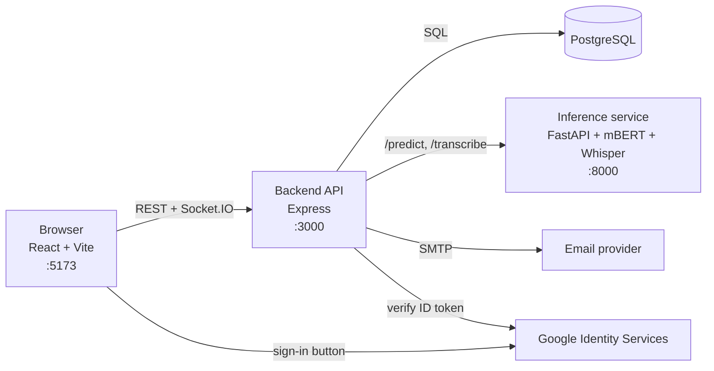

# Shift Handover Management System

A shift handover tool for Kenya Airways ground crew and supervisors. Crew write or speak their
handover in English, Swahili or a mix; a fine-tuned multilingual BERT model classifies the incident,
extracts aircraft, components, locations, roles, tasks and times, and writes a short summary. Each
handover raises a task and an alert for the incoming crew, and supervisors see what needs attention
across the shift, live.

## What it does

**Ground crew**
- Write a handover, or speak it (transcribed on the server by Whisper, English and Swahili). Spoken
  aircraft registrations ("five Yankee Kilo Zulu Delta") are written out as `5Y-KZD`.
- See the result straight away: category, confidence, entities, summary.
- My tasks, the previous shift's handovers to read, alerts, Day/Night filters.

**Supervisors**
- Overview of the shift: overdue, unassigned and low-confidence work, trends, recurring aircraft
  and components, team workload.
- Triage board: assign, unassign, set due times, resolve.
- Team: workload per person and people management (edit crew details, roles, deactivate,
  permanent delete with anonymisation of records).

**Everyone**
- Email and password or **Sign in with Google**; forgot-password by email; live updates over
  WebSockets; dark and light themes; works on phones.

## How it fits together



The browser only talks to the backend. The backend owns authentication, data and real-time push,
and calls the inference service for analysis and speech-to-text.

| Folder | What it is | Details |
|---|---|---|
| [`frontend/`](frontend) | React 19 + Vite web app | [README](frontend/README.md), [design](frontend/DESIGN.md) |
| [`backend/`](backend) | Express API, PostgreSQL, Socket.IO, email, Google sign-in | [README](backend/README.md) (all endpoints) |
| [`inference-service/`](inference-service) | FastAPI service: classification, NER, summary, Whisper | [README](inference-service/README.md) |
| [`machine-learning/`](machine-learning) | Data generation and processing, model training (Colab) | `src/`, `notebooks/` |
| [`e2e/`](e2e) | Playwright end-to-end tests of the whole app | [README](e2e/README.md) |

## Running it locally

**You need:** Node.js 20+, Python 3.14 (what the inference service is developed and tested on),
PostgreSQL 14+, and the trained model weights.

**Model weights.** `inference-service/model/best_model.pt` (about 680 MB) is not in git. Train it
with `machine-learning/src/training/train_classification_ner.py` (usage at the top of the file; it
was run on Google Colab, and `machine-learning/notebooks/training.ipynb` prepares the data there), or
get the file from the project owner. Then copy `best_model.pt` into `inference-service/model/` next
to `label_maps.json`.

Run each service in its own terminal:

**1. Inference service** (first start downloads mBERT, ~700 MB, and Whisper, ~1.6 GB)

```bash
cd inference-service
python3 -m venv venv
venv/bin/pip install -r requirements-dev.txt
venv/bin/uvicorn app.main:app --port 8000
```

Ready when it prints `Model ready.` and `Whisper ready (large-v3-turbo).`

**2. Backend**

```bash
cd backend
npm install
cp .env.example .env
npm run db:setup
npm run dev
```

Edit `.env` before `db:setup`: at least the `DB_*` values and a long random `JWT_SECRET`.

**3. Frontend**

```bash
cd frontend
npm install
cp .env.example .env
npm run dev
```

Open http://localhost:5173 and create an account. Everyone signs up as ground crew; make the first
supervisor from `backend/`:

```bash
npm run set-role -- you@example.com supervisor
```

**Optional:** Sign in with Google (`GOOGLE_CLIENT_ID` in both `.env` files) and real password-reset
emails (`SMTP_*` in `backend/.env`); see the backend README. Without them the Google button is hidden
and reset emails are printed in the backend terminal.

## Running it with Docker

The whole app (web server, backend, inference service and PostgreSQL) in containers, on one web
address. Needs Docker with **at least 8 GB of memory** for the containers (the models use about 3–5 GB),
and the model weights in `inference-service/model/` as above.

```bash
cp .env.example .env
docker compose up -d --build
```

Edit `.env` first: at least `DB_PASSWORD` and `JWT_SECRET` (e.g. `openssl rand -hex 32`). Then open
http://localhost:8080. The first start downloads mBERT and Whisper into a volume (about 6 minutes);
later starts take seconds. Make the first supervisor with
`docker compose exec backend npm run set-role -- you@example.com supervisor`.

| Container | What it does |
|---|---|
| `web` | Caddy: serves the built frontend and forwards `/api` and `/socket.io` to the backend. With a domain in `SITE_ADDRESS` it gets HTTPS certificates itself |
| `backend` | The API; brings the database up to date on every start (`npm run db:setup`) |
| `inference` | Models; weights mounted read-only from `inference-service/model`, downloads cached in a volume |
| `db` | PostgreSQL 16; data in the `db-data` volume |

Useful commands: `docker compose ps` (status), `docker compose logs -f backend` (logs),
`docker compose down` (stop; data is kept), `docker compose down -v` (stop and **delete all data**).

**On a server:** a Linux VPS with 8 GB of RAM and Docker. Point a domain at it and set
`SITE_ADDRESS=your.domain`, `PUBLIC_URL=https://your.domain`, `HTTP_PORT=80` and `HTTPS_PORT=443` in
`.env`; Caddy then serves HTTPS automatically (required for the microphone and Google sign-in). On a
platform that gives its own HTTPS address, keep `SITE_ADDRESS=:80`, point the platform at the web
container and set `PUBLIC_URL` to that address. Also set the `SMTP_*` settings for reset emails, add
`PUBLIC_URL` to the Google client's authorised JavaScript origins, and back up the `db-data` volume
(`docker compose exec db pg_dump -U shift shift_handover > backup.sql`).

## Tests

| Suite | Command | What it covers |
|---|---|---|
| Backend | `cd backend && npm test` | API, auth, Google sign-in, user management, filters and stats (separate `_test` database) |
| Inference | `cd inference-service && venv/bin/python -m pytest tests` | Entity decoding, registration normalising, Whisper prompt rules |
| Frontend | `cd frontend && npm run lint && npm run build` | Lint and production build |
| End to end | `cd e2e && npm install && npm run install-browser && npm test` | The whole app in a browser, on its own ports and database |

**On GitHub** all four run automatically, plus a check that the Docker images build ([`.github/workflows/ci.yml`](.github/workflows/ci.yml)) on
every pull request into `dev` or `main` and every push to them. CI needs no secrets or model files:
it uses throwaway PostgreSQL databases, the end-to-end suite's fake inference service, and only
`pytest` for the inference unit tests (the one test that needs the mBERT tokenizer skips itself).
If the end-to-end job fails, its HTML report (screenshots, traces) is attached to the run.

Model quality is measured separately with
`cd inference-service && venv/bin/python -m scripts.evaluate` (on 147 held-out handovers).

## Model

One mBERT encoder (`bert-base-multilingual-cased`) with two heads, trained jointly: incident
category (3 classes) and BIO entity tags (aircraft, component, location, role, task, time). The
summary is extractive. Baseline on the held-out test set (Oct 2026): category accuracy 0.62,
entity F1 0.65 for exact matches and 0.77 for partial matches. Known weak spots: TASK and LOCATION
entities, and fault words included in component names. See the inference-service README.

## Status

Working: everything listed under "What it does", with the tests above.

Next:
- Deployment to a server: the Docker setup is ready; hosting, a domain and production email remain.
- Multi-factor authentication (designed, postponed).
- Retraining for better entity accuracy.

## Branches

`main` is production and only changes through pull requests. Work happens on `feature/*` branches
and is merged into `dev` first.
